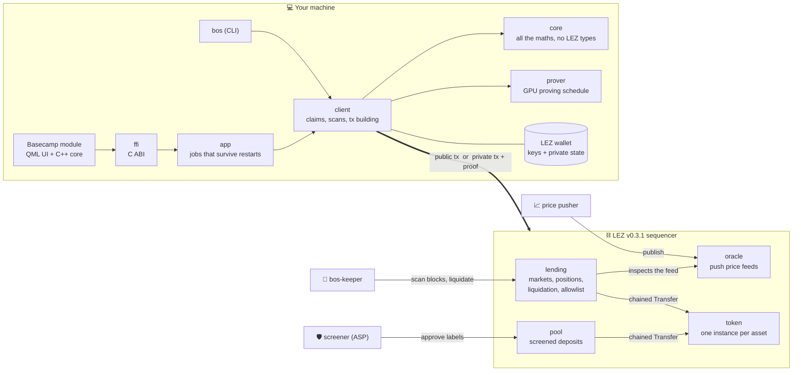
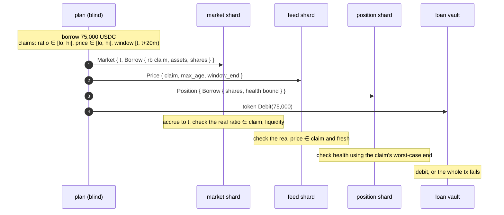
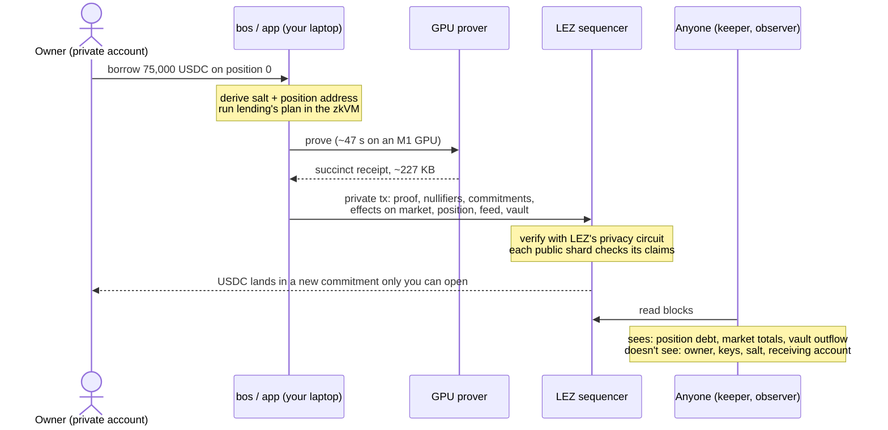
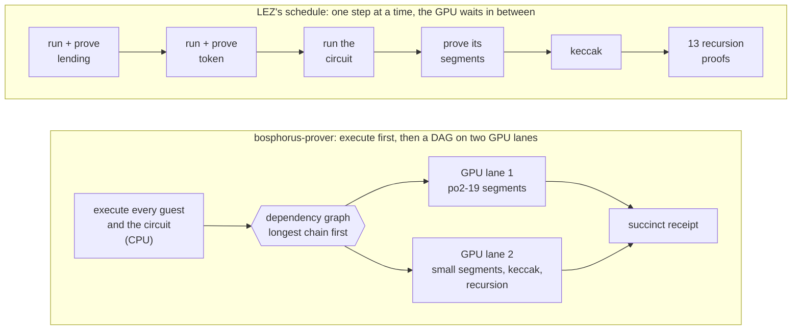
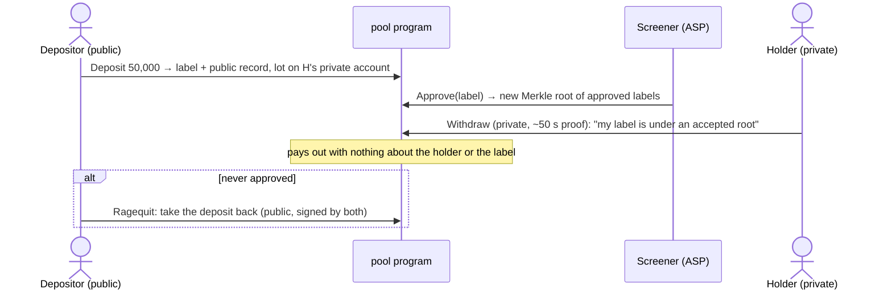
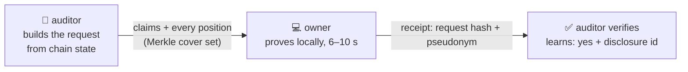

<div align="center">

# 🌊 Bosphorus

**Borrow and lend on Logos without telling the world it's you.**

A lending market on the [Logos Execution Zone](https://github.com/logos-blockchain/logos-execution-zone):
Morpho Blue-style isolated markets, private owners, and zero-knowledge proofs built on your own laptop's GPU.


[TL;DR](#-tldr) · [Architecture](#-architecture) · [Claims](#-the-bounds-pattern) · [Privacy](#-privacy) · [Prover](#-the-gpu-prover) · [Pool](#-screened-pool) · [Solvency proofs](#-solvency-proofs) · [Build](#-build) · [Limits](#-known-limits)

</div>

---

## ⚡ TL;DR

- **What it is.** A money market (supply, borrow, repay, liquidate) on LEZ v0.3.1. Markets are
  isolated and immutable, in the style of Morpho Blue, with an Aave-style kinked interest-rate
  curve.
- **What's private.** Positions are public, so anyone can check health and liquidate. **Who owns
  them isn't.** A private account acts on its positions through private transactions, and nothing
  published links a position to its owner. Lenders can go further and hold their shares inside
  their own private account, with no public position at all.
- **How.** LEZ makes privacy an account type. Our lending program's `plan` runs *inside the
  owner's own zero-knowledge proof*, and the sequencer verifies it with LEZ's own circuit. We
  didn't write a shielded pool or a verifier.
- **⚡ The optimized prover.** risc0 3.0.5 has no Metal backend, so a private borrow took
  **~10 minutes** on an M1. We wrote GPU kernels for it and our own proving schedule: **618 s → ~47 s**
  for a real borrow on an 8 GB M1 Air. A stock risc0 verifier accepts the proofs.
- **Compliance without surveillance.** A screened pool (Privacy Pools on LEZ) lets clean money in
  without saying whose it is. Solvency proofs let you show an auditor "one of these positions is
  mine and it's healthy" without saying which one.
- **Everything runs on your machine.** The app, the client, the maths, the prover and the wallet.
  There's no server and no account with us. Ships as a [Basecamp](https://logos.co) module.

```text
 ABOVE THE SURFACE · anyone sees
┌──────────────────────────────────┐
│ USDC  120,000.00   [ Dive ↓    ] │
│ WBTC        2.00   [ Dive ↓    ] │
└──────────────────────────────────┘               WHAT THE CHAIN SEES
                 │ dive                           ┌────────────────────────────────┐
~~~~~~~~~~~~~~~~~│~~~~~~~~~~~~~~~~~~              │ position    7f3a…c91e          │
                 ▼                                │ collateral  0.50 WBTC          │
┌──────────────────────────────────┐              │ debt        75,000 USDC        │
│ WBTC        0.50   [ Surface ↑ ] │  ─ proof ─▶  │ health      1.42               │
│ USDC   75,000.00   [ Pay back  ] │              │ owner       ░░░░░░  hidden     │
└──────────────────────────────────┘              │ signer      none               │
 BELOW THE SURFACE · your laptop                  └────────────────────────────────┘
```

---

## 🧭 Architecture



| Path | Crate | What it does |
|---|---|---|
| `core/` | `bosphorus-core` | All the lending maths: shares, interest, IRM, health, liquidation, claim intervals. Pure Rust, no LEZ types |
| `programs/lending/` | `bosphorus-lending` | Markets, positions, borrowing, liquidation, fees, asset allowlist |
| `programs/oracle/` | `bosphorus-oracle` | Push price feeds, U256 prices at Morpho's 1e36 scale |
| `programs/token/` | `bosphorus-token` | Fungible token for v0.3.1, shaped like the native token; one instance per asset |
| `programs/pool/` + `provenance/` | `bosphorus-pool` | The screened pool (Privacy Pools model); its maths lives in `provenance/` |
| `programs/disclosure/` + `disclosure/` | | Off-chain solvency-proof guest and its pure maths |
| `programs/methods/` | `bosphorus-methods` | Builds the guests and holds the in-process tests |
| `prover/` | `bosphorus-prover` | Drop-in for LEZ's `execute_and_prove` with our own GPU schedule |
| `client/` | | Builds, checks and sends txs over LEZ's `wallet` crate; block scanner |
| `cli/` | `bos` | Command line for tokens, oracle, lending admin, markets, pool, disclosure |
| `keeper/` | `bos-keeper` | Liquidation bot for trusted markets |
| `app/` | `bos-app` | JSON-lines API for front-ends, with jobs that survive restarts |
| `ffi/` | | The app over a C ABI (`ffi/bosphorus_ffi.h`) |
| `basecamp/` | | The Basecamp module: C++ core and QML UI |
| `spikes/` | | Platform experiments; `spikes/vendor/` holds the patched risc0 crates |
| `scripts/` | | End-to-end script per phase, testnet deploy, price pusher, proving benchmark |

> **Why `core` has no LEZ types.** The lending guest builds from `core`, so its image id is a
> function of the maths. Keeping LEZ glue out means a platform change (LEZ's coming actor model)
> only rewrites the glue, and new programs get their own pure crate so they can't change lending's
> image id by accident.

---

## 📐 The bounds pattern

LEZ v0.3.1 has an unusual execution model, and every program here is shaped by it:

1. **`plan` is blind.** A program decides what a tx does without reading any state.
2. **Each `apply` sees one shard.** The effects are then applied account by account, and each
   step sees only its own account.

So a borrow can't "look up the share price and check health". Instead, **every op carries claims**
about the state it can't see, and **each shard checks the claims that concern it**:



The maths in `core` is written so that **any value inside a claimed interval leaves lenders no
worse off**. Conversions always round in the protocol's favour from the conservative end of each
claim, and that's property-tested.

<details>
<summary><b>Market maths at a glance</b></summary>

| Piece | Rule |
|---|---|
| Shares | Morpho Blue, with virtual offsets (1e6 shares, 1 asset) against first-depositor inflation |
| Interest | Linear-kink IRM (Aave-shaped), compounded per accrual, capped at 10,000% APR |
| Health | `collateral × price × LLTV ≥ debt`, with `price.lo` and `ratio.hi` |
| Liquidation incentive | Morpho's `min(1.15, 1 / (1 − 0.3·(1 − LLTV)))` |
| Bad debt | Seize-all liquidations socialise the remainder across suppliers |
| Fees | Up to 25% of interest, minted as supply shares to the fee recipient |
| Assets | On-chain allowlist; market assets must run allowlisted, immutable bytecode |

</details>

---

## 🔒 Privacy

### One private op, end to end



The owner's id, keys and position salt are witnesses: they never leave the machine. Private txs
pay no fee for now, so no public account signs or pays, and none is linked. Every private tx
carries 7 padded notes, so the number of real private accounts doesn't show.

### Position addresses

A position's address comes from its owner through a salt only the owner can compute. Positions can
be recovered from the wallet mnemonic alone by walking `index = 0, 1, …`.


### Who sees what

| Flow | Public sees | Hidden |
|---|---|---|
| Public op | everything, including the owner (signer) | nothing |
| Dive (shield) | source account, token, amount | which private account |
| Private supply, borrow, repay, withdraw | position contents and history, amounts, claims, `t` to the minute | owner, salt, payer, receiver |
| Two positions of one owner | two unrelated addresses | that they're linked |
| Held lender shares (`--held`) | market totals, vault delta | that a position exists at all |
| Liquidation of a private position | everything about the liquidation | owner |

### What still leaks

- **Amounts and timing.** A distinctive amount, or a dive followed quickly by a supply, can link
  steps. Use unrelated amounts and let time pass.
- **Position contents.** Collateral, debt and liquidation price are public by design, so that
  anyone can liquidate. Hiding them is the next design (escrowed private positions).
- **The RPC operator** sees which accounts your client looks up and from where. On testnet that's
  the sequencer.
- **A small anonymity set** while few people use private mode.

---

## 🚀 The GPU prover

A private tx is only usable if proving it is. Out of the box, LEZ v0.3.1 proves with risc0 3.0.5,
which **has no Metal (Apple GPU) provers**. Its Metal flags compile kernels and then prove on the
CPU. On an 8 GB M1 Air, one private borrow took **618 s**.

We fixed that in two layers. Neither one touches the LEZ circuit or the receipt format.

### 1. GPU kernels (`spikes/vendor/`)

Vendored risc0 crates with Metal kernels for the whole segment prover, each one **bit-exact with
risc0's CPU code**:

- fused NTT and Merkle/FRI on the GPU;
- regenerated constraint kernels (flat sums, 400-op kernels, shared values stored);
- a register-resident Poseidon2 sponge and a 3-multiply Montgomery product for `Fp`;
- the rv32im accumulate step ported from risc0's CUDA;
- a NEON evaluator for the CPU's share of the constraint domain;
- all-zero groups committed without NTTs, and per-program recursion control groups cached;
- po2-19 segments, which cut peak memory from 9.8 to 5.2 GB so the prover fits in 8 GB.

### 2. Our own schedule (`prover/`)

LEZ proves each guest the moment it runs, then the circuit's segments, its keccak proof and 13
recursion proofs one after another, so the GPU sits idle through every CPU-only phase.
`bosphorus-prover` is a drop-in for `execute_and_prove` that **executes everything first, then
proves the whole dependency graph on two GPU lanes**:



It also proves keccak at po2 14 instead of 17 (65 permutations per private account fit in 81
rows, not 131,072), and warms the GPU pipelines up when the app opens, so the first proof doesn't
pay ~60 s of kernel compilation.

### Results (8 GB M1 Air, real proofs)

| | Time | |
|---|---:|---|
| Private borrow, CPU (LEZ's default path) | 618 s | `████████████████████████████████████████` |
| Private borrow, GPU kernels + LEZ's schedule | 54.6 s | `███▌` |
| **Private borrow, GPU kernels + `bosphorus-prover`** | **~47 s** | `███` |
| Screened-pool deposit / withdrawal | 48.8 s / 50.5 s | `███` |
| Solvency proof, any market size | 6–10 s | `▌` |

- **Verified the boring way.** A stock verifier (crates.io risc0-zkvm 3.0.5, none of our patches,
  `spikes/stockverify`) accepts the proofs against LEZ v0.3.1's circuit image id, and rejects them
  with one journal bit flipped. The seal and receipt sizes match LEZ's own path.
- **End to end in the app**, with syncing and sending, a private op takes 60–75 s.
- **The floor on this machine** is ~29 s: constraint evaluation and Poseidon2 alone need that at
  the M1 GPU's peak multiply rate.
- **CUDA** (NVIDIA) builds use risc0's stock CUDA backend, behind an opt-in feature. Without a GPU,
  proving falls back to the CPU.

```sh
./scripts/bench-proving.sh              # GPU if available, else CPU
BENCH_CPU=1 ./scripts/bench-proving.sh  # CPU only: the number to compare across machines
```

---

## 🛡 Screened pool

*"What if it's dirty money?"* The pool brings the Privacy Pools model to LEZ as one ordinary program,
with LEZ's private accounts doing the hiding.



- The screener **can approve, but can't move anyone's money**. If you're never approved, you can
  always take your deposit back, and nobody else can.
- A withdrawal touches three public accounts and names neither the holder nor the label.
- The approved set is an incremental Merkle tree (depth 11) so the screener's gas stays flat as it
  grows.

## 📜 Solvency proofs

*"Are you good for it?"* An auditor asks for something like **"one of this market's positions is
yours, with health ≥ 1.5 and collateral ≥ 1.5 WBTC"**. You prove it against every position in the
market at once, off chain:



The guest re-derives the owner's salt and position address from the spending key, checks the
claims with `core`'s health maths, and walks the Merkle path. The auditor learns that the claim
holds and a stable pseudonym, not which position it is. Nothing is deployed for this, and
lending's image id doesn't change.

---

## 🛠 Build

Needs the Rust toolchain in `rust-toolchain.toml` and the risc0 toolchain (`rzup`) for the guests.
Guests are built locally with `risc0_build::embed_methods`, not Docker, so image ids differ from
Docker builds.

```sh
# Rust: rust-toolchain.toml installs 1.98.1 on the first build
curl --proto '=https' --tlsv1.2 -sSf https://sh.rustup.rs | sh -s -- -y
source "$HOME/.cargo/env"

# risc0 toolchain (open a new terminal after the install script so rzup is on PATH)
curl -L https://risczero.com/install | bash
rzup install cargo-risczero 3.0.5
rzup install r0vm 3.0.5
rzup install rust 1.97.0
```

```sh
cargo build --release -p bosphorus-cli -p bosphorus-keeper -p bosphorus-app
cargo test -p bosphorus-core
RISC0_DEV_MODE=1 cargo test -p bosphorus-methods
```

<details>
<summary><b>GPU setup (Metal or CUDA)</b></summary>

For Metal, install Xcode from the App Store, then:

```sh
sudo xcode-select -s /Applications/Xcode.app
xcodebuild -downloadComponent MetalToolchain
xcrun -sdk macosx metal --version   # should print "Apple metal version ..."
```

For CUDA, install the CUDA toolkit so that `nvcc` and `nvidia-smi` are on `PATH`. Close the
browser and other heavy apps before benchmarking; they skew the timings.

</details>

## ▶️ Run locally

You need a LEZ checkout at tag `v0.3.1` for the sequencer and the wallet:

```sh
cd ../logos-execution-zone   # at v0.3.1
cargo build --release --features standalone -p sequencer_service
cargo build --release -p wallet
```

Start a dev-mode sequencer from this repo (state goes in `.localnet/`, delete it to reset):

```sh
mkdir -p .localnet
RISC0_DEV_MODE=1 ../logos-execution-zone/target/release/sequencer_service \
  scripts/localnet/sequencer_config.json > .localnet/sequencer.log 2>&1 &
```

Then run the end-to-end scripts. They expect the wallet binary at
`~/Work/logos-execution-zone/target/release/wallet`; set `WALLET=` to point elsewhere.

| Script | Covers |
|---|---|
| `scripts/phase2-e2e.sh` | tokens, oracle, a market, the public lending lifecycle |
| `scripts/phase3-e2e.sh` | liquidations by the keeper, fee claims |
| `scripts/phase4-e2e.sh` | private positions, recovery by index, tx privacy reports |
| `scripts/e9-held.sh` | lender shares held on a private account |
| `scripts/e10-pool.sh` | the screened pool: deposit, approve, withdraw, ragequit |
| `scripts/e11-disclosure.sh` | solvency proofs: request, prove, verify |
| `scripts/app-e2e.sh` | the `bos-app` API, including restarts mid-job |
| `scripts/ffi-smoke.sh` | the C ABI |

`NETWORK=testnet` points the Phase 5 scripts (`phase5-deploy.sh`, `phase5-public.sh`,
`phase5-private.sh`) at `https://testnet.lez.logos.co` with real proofs. Deployed ids are in
[DEPLOYMENTS.md](DEPLOYMENTS.md).

## ⌨️ Using `bos`

```sh
bos check --lending <id>                     # privacy circuit and deployed programs match this build
bos market list --lending <id>
bos status --lending <id> --market <hex>
bos market supply --lending <id> --market <hex> --from Public/... --assets 1000000
bos market borrow --lending <id> --market <hex> --owner Private/... --index 0 --assets 500000
bos pool deposit ...                         # a screened dive; `bos pool --help`
bos disclose prove ...                       # a solvency proof; `bos disclose --help`
bos tx-report --tx <hash> --owner Private/... --market <hex> --check  # what a tx published, scanned for the owner's bytes
```

Any op with a `Private/` owner, sender or payer goes out as a private transaction. `bos --help`
lists the rest.

---

## ⚠️ Known limits

Bosphorus is experimental and **not audited**. We review it ourselves and track every finding;
these are the ones that matter most today:

- **Position contents are public** (collateral, debt, liquidation price). Only the owner is hidden,
  so this doesn't stop someone hunting a large position's liquidation price.
- **Liquidations claim the position's exact contents**, so a position that changes between the
  keeper's read and inclusion makes the liquidation fail and retry. Moving to lower-bound claims
  is planned.
- **Market trust is the client's job**, as on Morpho: markets are permissionless, so the app and
  keeper must only act on vetted markets and feeds. Tightening both is in progress.
- **The oracle is a single push publisher** with no deviation bounds.
- **Private borrowers rescue slowly**: a top-up or repay takes about a minute to prove, so borrow
  with a wide margin.
- **Solvency proofs' anonymity depends on the cover set**, which a hostile auditor can shrink.
- **Risk features:** the IRM is Aave-shaped, but Aave v3's borrow-LTV split, supply and borrow caps
  and close factor aren't built yet.
- **Targets LEZ v0.3.1 only**, and programs are immutable: a new build means a new deployment.
  `bos`, the keeper and the app refuse programs that aren't their own build. To prove against a
  deployment you need its exact ELFs (`bos programs --write-dir`). The testnet deployment in
  `DEPLOYMENTS.md` runs older lending code than `main`.

## License

MIT OR Apache-2.0.
