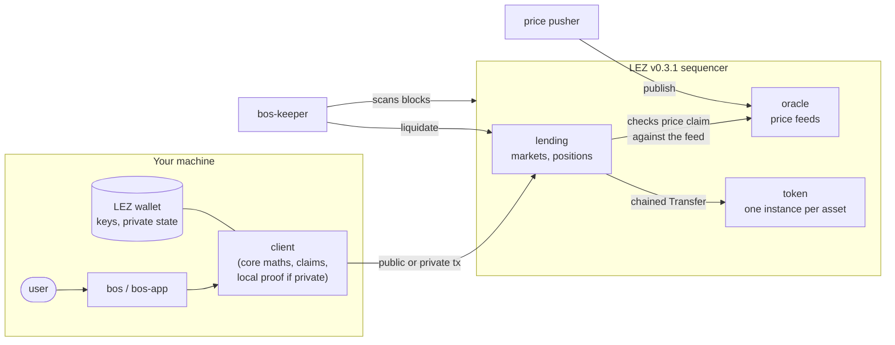
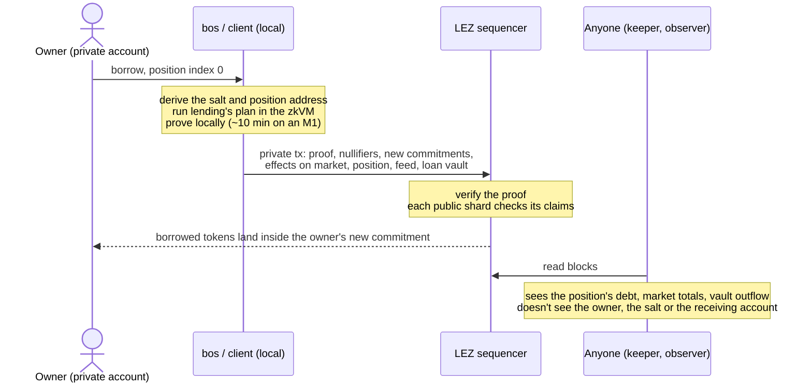
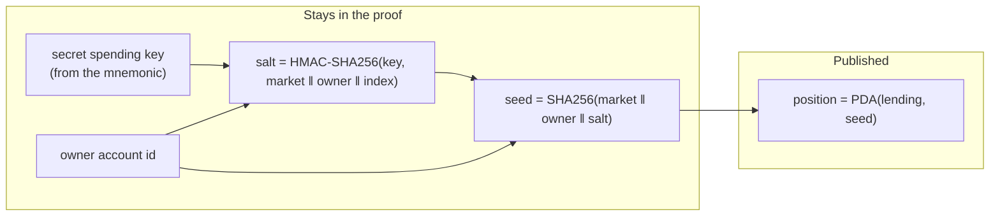
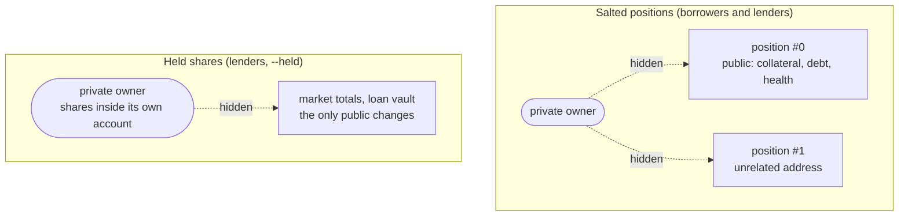

# Bosphorus

A lending market on [Logos LEZ](https://github.com/logos-blockchain/logos-execution-zone) v0.3.1:
Morpho Blue-style isolated, immutable markets with some Aave v3 risk features, plus privacy.
Positions are public, so anyone can check health and liquidate. Their owners can be hidden: a
private account acts on its positions through private transactions, and nothing published links
a position back to its owner.

Status: experimental. Runs on a local dev-mode sequencer and on the LEZ testnet (see
[DEPLOYMENTS.md](DEPLOYMENTS.md)). Not audited.

## What's here

| Path | Crate | What it does |
|---|---|---|
| `core/` | `bosphorus-core` | All the maths (shares, interest, IRM, health, liquidation, claim intervals). Pure Rust, no LEZ types |
| `programs/token/` | `bosphorus-token` | Fungible token for v0.3.1, shaped like the native token; one program instance per asset |
| `programs/oracle/` | `bosphorus-oracle` | Push price feeds, U256 prices at Morpho's 1e36 scale |
| `programs/lending/` | `bosphorus-lending` | Markets, positions, borrowing, liquidation, fees, asset allowlist |
| `programs/methods/` | `bosphorus-methods` | Builds the guests (risc0) and holds the in-process tests |
| `client/` | | Builds, checks and sends txs on top of LEZ's `wallet` crate; block scanner for markets and positions |
| `cli/` | `bos` | Command line for tokens, oracle, lending admin, markets and positions |
| `keeper/` | `bos-keeper` | Liquidation bot: finds positions by scanning blocks, liquidates unhealthy ones in trusted markets |
| `app/` | `bos-app` | JSON-lines API over stdin/stdout for front-ends, with jobs that survive restarts |
| `spikes/` | | Platform experiments from the start of the project (gas, proving, privacy) |
| `scripts/` | | End-to-end scripts per phase, testnet deploy and scenarios, price pusher |

## How it works



LEZ programs can't read state while planning a transaction, and each `apply` sees only one account
shard. So every op carries claims about state it can't see (a ratio interval, a price interval, a
validity window), and each shard checks the claims that concern it. The maths in `core` makes sure
any value inside a claimed interval leaves the protocol no worse off.

## Privacy

Positions stay public so that anyone can liquidate them. What's hidden is who owns them.

### A private op

The owner is a private account. The lending program's `plan` runs inside the owner's own proof,
so the owner's id, keys and position salt are witnesses and never leave the machine. Only the
effects on public accounts are published.



Private txs pay no fee for now, so no public account signs or pays, and none is linked.

### Position addresses

A position's address is derived from its owner, but through a salt that only the owner can
compute. The salt is keyed by the private account's secret key, so positions can be recovered from
the wallet mnemonic by walking `index = 0, 1, …`. Without the salt, anyone who knows the owner's
private account id could compute its position addresses.



### What can be linked

All actions on one position share its address, so they're linked. Two positions of the same owner
have unrelated addresses. A lender can go further and hold supply shares on their own private
account (`--held`): then there's no public position at all, and supply and withdraw only change
the market totals and the loan vault. Borrowing always uses a public position, because a position
with debt has to stay liquidatable.



### What still leaks

- **Exact amounts.** A distinctive amount can link a shield to a supply, or a borrow to a later
  withdrawal from the private pool. A full `--held` withdrawal burns exactly the shares its
  supply minted.
- **Timing.** Shield, act and unshield in quick succession and the steps line up.
- **Getting tokens in.** Shielding a token shows the source account and the amount.
- **The client's settings.** Claims are published as they are, so every client uses the same
  private defaults (`ClaimConfig::private()`) and rounds the window start down to the minute,
  so that it doesn't show when proving started.
- **A small anonymity set**, while few people use private mode.

## Build

Needs the Rust toolchain in `rust-toolchain.toml` and the risc0 toolchain (`rzup`) for the guests.
Guests are built locally with `risc0_build::embed_methods`, not Docker, so image ids differ from
Docker builds.

```sh
# Rust: rustup; rust-toolchain.toml installs 1.98.1 on the first build
curl --proto '=https' --tlsv1.2 -sSf https://sh.rustup.rs | sh -s -- -y
source "$HOME/.cargo/env"

# risc0 toolchain (open a new terminal after the install script so rzup is on PATH)
curl -L https://risczero.com/install | bash
rzup install cargo-risczero 3.0.5
rzup install r0vm 3.0.5
rzup install rust 1.97.0
```

```sh
cargo build --release -p bosphorus-cli -p bosphorus-keeper -p bosphorus-app
cargo test -p bosphorus-core
RISC0_DEV_MODE=1 cargo test -p bosphorus-methods
```

## Benchmark proving

`scripts/bench-proving.sh` proves one private borrow with a real proof and prints the time next to
the machine it ran on. It uses the GPU if it finds one (Metal on Apple Silicon, CUDA on NVIDIA),
otherwise the CPU through `r0vm`. On an M1 with 8 GB: ~36 s on Metal, ~7–10 min on the CPU.

```sh
./scripts/bench-proving.sh              # GPU if available, else CPU
BENCH_CPU=1 ./scripts/bench-proving.sh  # CPU only: the number to compare across machines
```

For the Metal path, install Xcode from the App Store, then:

```sh
sudo xcode-select -s /Applications/Xcode.app
xcodebuild -downloadComponent MetalToolchain
xcrun -sdk macosx metal --version   # should print "Apple metal version ..."
```

For the CUDA path, install the CUDA toolkit so that `nvcc` and `nvidia-smi` are on `PATH`. Close
the browser and other heavy apps before running; they skew the timings.

## Run locally

You need a LEZ checkout at tag `v0.3.1` for the sequencer and the wallet:

```sh
cd ../logos-execution-zone   # at v0.3.1
cargo build --release --features standalone -p sequencer_service
cargo build --release -p wallet
```

Start a dev-mode sequencer from this repo (state goes in `.localnet/`, delete it to reset):

```sh
mkdir -p .localnet
RISC0_DEV_MODE=1 ../logos-execution-zone/target/release/sequencer_service \
  scripts/localnet/sequencer_config.json > .localnet/sequencer.log 2>&1 &
```

Then run the end-to-end scripts. They expect the wallet binary at
`~/Work/logos-execution-zone/target/release/wallet`; set `WALLET=` to point elsewhere.

```sh
scripts/phase2-e2e.sh    # tokens, oracle, a market, the public lending lifecycle
scripts/phase3-e2e.sh    # liquidations by the keeper, fee claims
scripts/phase4-e2e.sh    # private positions, recovery by index, tx privacy reports
scripts/e9-held.sh       # lender shares held on a private account
scripts/app-e2e.sh       # the bos-app API, including restarts mid-job
```

`NETWORK=testnet` points the Phase 5 scripts (`phase5-deploy.sh`, `phase5-public.sh`,
`phase5-private.sh`) at `https://testnet.lez.logos.co` with real proofs.

## Using `bos`

```sh
bos check --lending <id>                     # privacy circuit and deployed programs match this build
bos market list --lending <id>
bos status --lending <id> --market <hex>
bos market supply --lending <id> --market <hex> --from Public/... --assets 1000000
bos market borrow --lending <id> --market <hex> --owner Private/... --index 0 --assets 500000
bos tx-report --tx <hash> --owner Private/... --market <hex> --check  # what a tx published, scanned for the owner's bytes
```

Any op with a `Private/` owner, sender or payer goes out as a private transaction. `bos --help`
lists the rest.

## Caveats

- Targets LEZ v0.3.1 only. Earlier versions are incompatible.
- Programs are immutable, so a new build means a new deployment. `bos`, the keeper and the app
  refuse programs that aren't their own build (image ids). To prove a private tx against a
  deployment, you need the exact ELFs it was built from (`bos programs --write-dir`).
- The lending guest changed after the testnet deployment in `DEPLOYMENTS.md`, so that deployment
  runs older code than `main`.

## License

MIT OR Apache-2.0.
